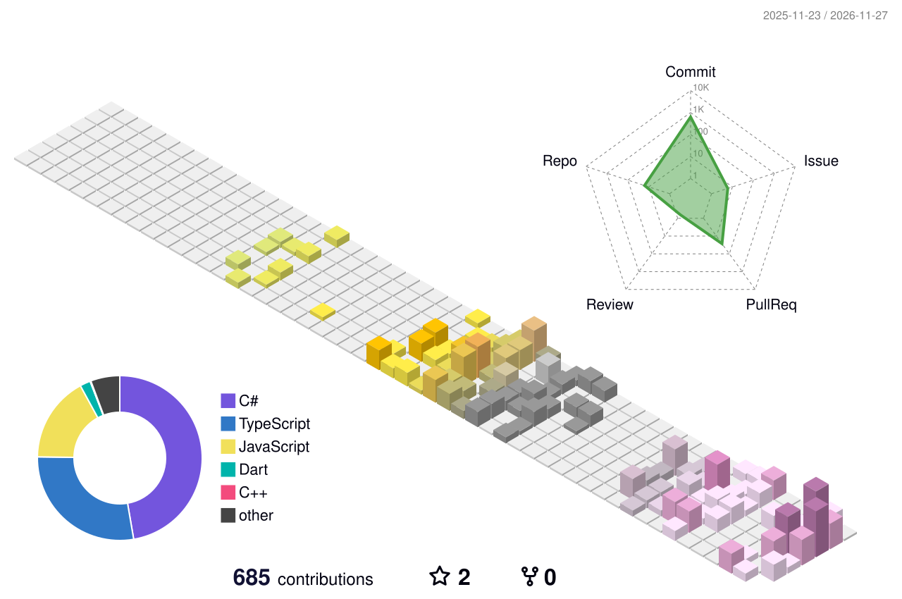

  
  
Software Engineering Student at FPT University

  
   
  
  
  
  

### About Me

Backend & Full-stack developer focused on building scalable systems, clean architecture, and modern web applications. Currently diving deeper into distributed systems, microservices, and DevOps.

### Core Stack

  

  <b>Backend:</b> ASP.NET Core, EF Core, SignalR  •  <b>Database:</b> SQL Server, PostgreSQL  •  <b>Frontend:</b> React, Vite, Tailwind CSS

### 3D Contributions

  <picture>
    <source media="(prefers-color-scheme: dark)" srcset="profile-3d-contrib/profile-night-rainbow.svg" />
    <source media="(prefers-color-scheme: light)" srcset="profile-3d-contrib/profile-south-season-animate.svg" />
    
  </picture>

  

  

  <picture>
    <source media="(prefers-color-scheme: dark)" srcset="https://raw.githubusercontent.com/chinsuhdh/chinsuhdh/output/snake-dark.svg" />
    
  </picture>

  <a href="mailto:buingoctam06042003@gmail.com">buingoctam06042003@gmail.com</a>  •  Ho Chi Minh City, Vietnam

